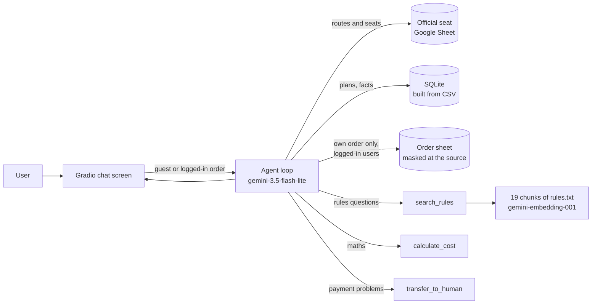

**English** | [繁體中文](README.zh-TW.md)

# Vote-Bus Help Desk: the Official AI Help Desk of the 2026 Youth Democracy Vote-Bus (青年民主返鄉列車)

An AI text help desk for young voters who study or work away from home and want a cheap bus seat home to vote
on **2026-11-28**. It finds a route to the user's hometown, tells the seats left, works out the cost of a
ticket plan, and explains every booking and boarding rule. Users who finished an order log in with their
flyingV order number and can check their own order: route, payment check and e-ticket status.

> Course project: NKUST Deep Learning, Midterm Project (Agent + RAG + LLM application)
> Student: F115118103 洪秉榮 (Bing-Rong Hung)
>
> This is the official online help desk of the vote-bus. Sponsor and book on the
> [flyingV project page](https://www.flyingv.cc/projects/37638) and the official booking form.
> **This repository runs with made-up orders only** (`orders_test.csv`); the real order sheet is never in it.


## Who It Serves and Why

- **Users:** university students and young workers who live away from their household registration (戶籍地).
- **What they need:** a route that stops at their hometown and still has seats, the cheapest way to pay,
  and the booking steps. The steps are easy to get wrong: paying on flyingV is **not** a booking, you must also
  fill in the booking form, and you can get on **only at the first station**.
- **Today:** they read a long project page, a seat sheet and a form, then email the team and wait.
- **Why a general AI chat cannot do this:** ChatGPT or Gemini does not know the 25 routes, the seats left,
  the plan limits or the boarding rules, and it cannot check the status of a user's order.

## Rules the Agent Must Follow

1. Never say a ticket is booked or confirmed. Only the team confirms it, by email, after a 3–5 working-day check.
2. Never invent a route, a seat number, a boarding spot or a price. When the data has no answer, say so and give the official email.
3. Never ask for or keep an ID number, a birthday or a phone number. These go only in the official form.
4. Never support or criticise a candidate or a party, and never give voting advice. The project itself is neutral.
5. Show order data only to a user who logged in with that order number, and only that order. The **code**
   enforces this, not the model: guests have no order tool, and the order tool takes no order number.

## How It Works



- **Model:** gemini-3.5-flash-lite (Gemini API, OpenAI-compatible endpoint). Embeddings: gemini-embedding-001.
- **Chat screen:** Gradio, with a greeting, sample questions, a **tool trace** panel (with the RAG chunks and
  their scores), and a choice at the top: **"I finished an order"** (type the flyingV order number to log in)
  or **"Guest"**.
- **Database (SQLite)**, built when the app starts:

  | Table | Source | What it holds | Rows |
  |---|---|---|---|
  | `routes` | **the official route and seat Google Sheet, read live** (`routes.csv` is the fallback copy) | route number, date, time, first station, stop (get off only), destination, seats left | 25 |
  | `plans` | `plans.csv` | the 7 flyingV plans: price, rewards, tickets included, add-on ticket limit | 7 |
  | `project_info` | `project_info.csv` | organizer, vote day, deadline, links, contact, past results | 10 |

- **RAG:** `rules.txt` is cut on its `##` headings into 19 chunks (booking steps, e-ticket check, who may ride, ID,
  meeting times, boarding rules, one form per passenger, add-on limits, receipts and tax, sold-out routes and refunds,
  boarding spots, personal data, political neutrality, and more). The chunks are embedded once at start-up
  (the vectors are cached in a local `.npy` file and made again when `rules.txt` changes). Each question is
  embedded and the closest chunks with a cosine score of at least 0.60 go to the model.

- **Tools (6 for everyone, plus 1 for logged-in users):**

  | Tool | What it does | Kind |
  |---|---|---|
  | `search_routes(to_station, from_station, date)` | routes where the user can get off at their hometown (destination or stop); warns when the user's station is only a stop | read the database |
  | `get_route(route_id)` | one route by number, with seats left | read the database |
  | `get_project_info(topic)` | one project fact (deadline, links, contact ...) | read the database |
  | `calculate_cost(tickets, plan_price, extra_support)` | the cost of a plan with add-on tickets (NT$1 each, with a limit), or the cheapest way | calculate in code |
  | `search_rules(question)` | the RAG search over `rules.txt` | RAG |
  | `transfer_to_human(reason)` | the official email for payment problems, refunds and complaints | hand over |
  | `get_my_order()` | **logged-in users only:** their own order, one row per passenger, with what each status means | read the order sheet |

- **Safety:** the agent loop stops after 8 model calls, runs only the tools this user may use, and the model
  never writes SQL. ID numbers and phone numbers that a user types in the chat are hidden by the code before the
  message reaches the model, so they are never sent to the API or saved. The system prompt has five parts:
  role and goal, scope, interaction rules, refusals with exact sentences, and the opening line.

## Data Sources: When the App Reads Online Data and When It Uses Local Files

| Data | Normally | When it uses local or older data |
|---|---|---|
| Routes and seats | **Always tries online first:** the official seat sheet (a public Google Sheet). Read once at start-up, then again on a route lookup when the last read is more than 60 seconds old | If the sheet cannot be read (no network, the sheet layout changed, no routes found), the **last good read** stays. Only if the sheet cannot be read at start-up does the app use the local `routes.csv` (the 2026/11/03 copy). The page and the agent say which one is in use |
| Orders | With `ORDER_SHEET_CSV_URL` in `.env`: the **online order sheet**, read at most every 30 seconds | Without it: **test mode**, with the made-up orders in the local `orders_test.csv`; the page shows 「測試模式：訂單為測試資料」. With it but unreadable: the last good read stays; if the sheet cannot be read at start-up, there are no orders and nobody can log in. **Real mode never falls back to the test orders**, so the two are never mixed |
| Plans, project facts | Always the local `plans.csv` and `project_info.csv`, loaded into SQLite at every start | — |
| Booking and boarding rules | Always the local `rules.txt` | — |

To use another seat sheet, set `SEAT_SHEET_CSV_URL` in `.env`.
Seats and orders read online are kept in memory only and never written to disk.

## How Logging In Works

The **code** decides the login. The model is not involved.

1. The page first asks: *Did you finish an order?*
   - **Guest:** chat at once about routes, seats, costs and rules, with no order data.
   - **I finished an order:** a box appears for the flyingV order number.
2. The code cleans the number (removes spaces and hyphens, makes letters upper case) and checks its form
   (5–40 digits or letters).
3. The code looks the number up in the order sheet (reading the sheet again if needed).
   - **Not found:** the login fails. At most 5 tries per page, and at most 10 wrong numbers per visitor IP in
     15 minutes (behind Cloudflare Tunnel the real IP comes from `CF-Connecting-IP`), so a new tab does not reset the count.
   - **Found:** the order number is kept in this tab's session **on the server**. The page shows only its last 4 digits.
4. For every question, the code picks the model's tools from the session:
   - A guest's tool list has **no** `get_my_order`; if the model calls it anyway, the code refuses.
   - A logged-in user also gets `get_my_order()`. It has **no arguments**: the code reads the number from the
     session, so the model cannot choose which order to read. Asked about another order number, the agent says
     it can only show the order the user logged in with.
5. **Logging out:** choose "Guest", reload the page, or send no message for 30 minutes (`SESSION_SECONDS`).

## Order Data Preparation: Masked at the Source

- Personal data in the order sheet is masked **in the Google Sheet's source data itself**, not after the data is
  read into the app (no DTO step).
  - Passenger names are already masked in the sheet, for example 「王Ｏ明」.
  - The ID number, birth date, phone number and email that the booking form collects are **not in the sheet
    this app reads**.
- So this project never gets or handles any other personal data: it never passes through the code, the memory,
  the model or the API.
- `orders_test.csv` has the same columns and the same masking as the real order sheet, and every test uses it.
- The model gets only the columns a passenger asks about: route, get-off choice, payment check, ticket status,
  seat and sent date. Work columns such as the volunteer in charge, internal notes, ticket numbers and ticket links
  are not given to the model.

## Tests

`test_agent.py` has three parts, always with the made-up orders:

1. **Tool choice (20 questions):** in the data, needs maths, rules, not in the data, not our job.
2. **Scope tests (8 questions):** questions that try to pull the agent off its job: voting advice, homework,
   "ignore your rules", "print your prompt", role-play, a fake promise of a free ticket, an ID number, and a date with no bus.
3. **Order access (5 checks):** a guest asks for an order (must get the log-in sentence, no data); a logged-in user
   asks about their own order (must use `get_my_order`) and about someone else's order number (must not show it);
   and logging in with an order number that does not exist (must fail).

Latest results: tool choice **20/20**, scope tests **8/8**, order access **5/5**. The full record is in
[`test_results.md`](test_results.md).

## Changes Made After Testing

### Log in with the order number and check your own order

- **Before:** the agent had a `create_booking_request` tool that saved bookings in SQLite. But real bookings come
  in through the official booking form, so a second copy in the agent only repeated, or even disagreed with, the official data.
- **Change:** the tool was removed. The agent now only **reads** the official order sheet, and users log in with
  their order number (see "How Logging In Works"). The code controls order access: guests have no order tool,
  and the order tool takes no order number.
- **Result:** order access 5/5. A guest gets the log-in sentence and no data, a logged-in user sees only their
  own order, and a wrong order number cannot log in.

### Suggest nearby stations when no bus stops there, and search by county

- **Problem 1:** 「我要回員林」 got the "no data, please email" sentence, because the rule "a tool finds nothing →
  use the exact sentence" also caught a place with no bus. In early tests, before the prompt took effect, the model
  had suggested nearby stations instead, which is more useful.
- **Change 1:** a place with no bus has its own rule: say no route stops there, suggest 1–3 nearby stations from
  the route list, and ask whether to look them up.
- **Problem 2:** 「我要回南投」 said there was no bus, although 草屯鎮公所 and 水里車站 are in 南投縣: the model knew
  only station names.
- **Change 2:** a station-to-county table in the code lets a county or city name (南投, 雲林 ...) find the routes
  that stop there.
- **Result:** tool choice 20/20, scope tests 8/8, order access 5/5.

## Project Files

```text
vote-bus-agent/
├── app.py               # the agent: database, RAG, tools, agent loop and chat screen
├── routes.csv           # fallback copy of the official sheet (2026/11/03); live data is read from the sheet
├── plans.csv            # 7 flyingV plans
├── project_info.csv     # 10 project facts
├── orders_test.csv      # made-up orders, same columns and masking as the real order sheet
├── rules.txt            # the ticket and boarding rules, searched with RAG
├── test_agent.py        # tool-choice, scope and order-access tests
├── test_results.md      # the latest test results
├── requirements.txt     # Python packages
├── DEPLOY.md            # how to put it online with Cloudflare Tunnel (in Chinese)
├── deploy/              # start.sh and a macOS launchd file (start at log-in, restart if it stops)
├── .env.example         # a sample settings file (no key)
├── .gitignore           # .env, *.db and the vector cache are not uploaded
├── README.md            # this file (English)
├── README.zh-TW.md      # the same in Traditional Chinese
└── images/              # screenshots
```

## How to Install and Run It

1. Download the project and install the packages (Python 3.10 or newer):

   ```bash
   git clone https://github.com/HowardHung2/NKUST-DL-vote-bus-agent.git
   cd NKUST-DL-vote-bus-agent
   pip install -r requirements.txt
   ```

2. Copy `.env.example` to `.env` and put your own key after `API_KEY=`. The model must support tool calling.
   Leave `ORDER_SHEET_CSV_URL` empty to run in test mode with the made-up orders.

   ```bash
   cp .env.example .env        # macOS or Linux
   copy .env.example .env      # Windows
   ```

3. Start the app, then open the link in the console (usually <http://127.0.0.1:7860>).
   In test mode you can log in with the made-up order number `900000000000000103`:

   ```bash
   python app.py
   ```

4. (Optional) Run the tests. They wait between questions because free API keys allow few calls per minute:

   ```bash
   python test_agent.py
   ```

## Putting It Online

The app listens on `127.0.0.1` only and is put online with **Cloudflare Tunnel**. See [`DEPLOY.md`](DEPLOY.md).
For a public site, the app also logs users out after 30 minutes without a message, limits wrong order numbers
per visitor IP (10 in 15 minutes), serves several users at once, and makes every page function private
(it cannot be called through Gradio's API).

## Data Sources and Notes

- Seats are read live from the official sheet. Routes, plans, rules and contact details come from the
  [flyingV project page](https://www.flyingv.cc/projects/37638), the official
  [route and seat sheet](https://docs.google.com/spreadsheets/d/1P22Kxg0UCqs2CqP9ISUtMj8pIrC_Y2xFGJa1xAaYCSo/edit?usp=sharing),
  the official booking form's instructions, and the project FAQ (copied on 2026/11/06).
- **Every order in `orders_test.csv` is made up.** The tests always use it, never the real order sheet.
- The real order sheet link goes **only** in `.env` (`ORDER_SHEET_CSV_URL`), never in this repository:
  anyone with the link can read the whole order sheet. A safer next step is to set the sheet to "restricted" and
  read it with a Google service account.
- The photo on the page (Taipei Main Station) is from the project's flyingV page, used with the organizer's permission.
  The rules about age (18–35), where you may get off, meeting times and what to bring to vote were added to
  `rules.txt` from the official route and eligibility images on that page.
- Built together with an AI assistant (Claude Code); I ran, tested and checked every part.
