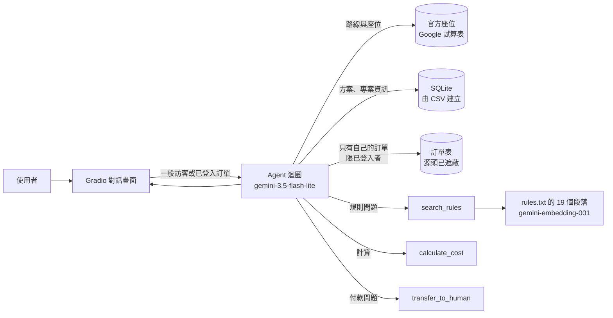
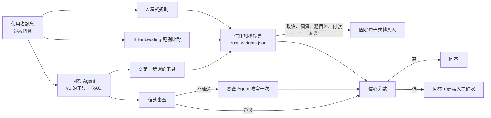

[English](README.md) | **繁體中文**

# 返鄉列車線上客服：2026 青年民主返鄉列車官方 AI 客服

這是一個 AI 文字客服，服務在外地求學或工作、想用便宜車資回家在 **2026-11-28** 投票的青年。
它能找出到使用者家鄉的班次、告訴他還剩幾個座位、計算車票方案的費用，並說明所有訂票與乘車規則。
已完成訂單的使用者可以用 flyingV 訂單編號登入，查詢自己的訂單：車次、對帳狀態和電子車票狀態。

> 課程專案：高科大「深度學習」期中專案（Agent + RAG + LLM 應用）
> 學生：F115118103 洪秉榮
> 目前版本：**v1.0.0**（第一個穩定版，見[版本紀錄](#版本紀錄)）
>
> 這是返鄉列車的官方線上客服。贊助與訂票請到 [flyingV 專案頁](https://www.flyingv.cc/projects/37638)，並填寫官方訂票表單。
> **本 repository 只使用假訂單**（`orders_test.csv`），真實的訂單表從未放進來。

## 服務對象與原因

- **使用者：** 戶籍地不在求學或工作所在地的大學生和年輕上班族。
- **他們需要：** 一班會停在家鄉、而且還有座位的車；最省錢的付款方式；以及訂票步驟。
  這些步驟很容易弄錯：在 flyingV 付款**不等於**訂到票，還要填訂票表單；而且**只能在發車站上車**。
- **現在的做法：** 自己讀很長的專案頁、座位表和表單，再寫信給工作團隊，然後等回覆。
- **為什麼一般 AI 聊天做不到：** ChatGPT 或 Gemini 不知道這 25 條路線、剩餘座位、各方案的加購上限和上車規則，
  也無法查詢使用者的訂單狀態。

## 客服必須遵守的規則

1. 不能說車票已經訂好或已確認。只有工作團隊能確認，要經過 3–5 個工作天人工核對，再以電子郵件通知。
2. 不能編造路線、座位數、上車地點或價格。資料裡沒有答案時要直接說，並提供官方信箱。
3. 不能詢問或保存身分證字號、生日或手機號碼。這些資料只填在官方表單裡。
4. 不能支持或批評任何候選人或政黨，也不能給投票建議。這個計畫本身是中立的。
5. 訂單資料只給用該訂單編號登入的使用者看，而且只能看那一筆訂單。這條規則由**程式**執行，不是靠模型：
   一般訪客根本沒有訂單工具，而訂單工具也不接受訂單編號作為參數。

## 運作方式



- **模型：** gemini-3.5-flash-lite（Gemini API，OpenAI 相容端點）。Embedding：gemini-embedding-001。
- **對話畫面：** Gradio，有開場白、範例問題、**工具軌跡**面板（含 RAG 找到的段落與分數）。
  頁面上方可以選擇 **「已完成訂單」**（輸入 flyingV 訂單編號登入）或 **「一般訪客」**。
- **資料庫（SQLite）**，程式啟動時建立：

  | 資料表 | 來源 | 內容 | 筆數 |
  |---|---|---|---|
  | `routes` | **官方路線及剩餘座位 Google 試算表，即時讀取**（`routes.csv` 是備份） | 車次、日期、時間、發車站、停靠站（只下不上）、終點、剩餘座位 | 25 |
  | `plans` | `plans.csv` | flyingV 的 7 種方案：價格、回饋、內含車票、可加購張數 | 7 |
  | `project_info` | `project_info.csv` | 主辦單位、投票日、募資期限、連結、聯絡方式、歷年成果 | 10 |

- **RAG：** `rules.txt` 依 `##` 標題切成 19 個段落（訂票步驟、電子車票核對、乘車資格、證件、集合時間、上車規則、
  一份表單一位乘客、加購上限、收據與抵稅、班次額滿與退票、上車地點、個人資料、政治中立等）。
  啟動時把這些段落轉成向量一次（向量快取在本地的 `.npy` 檔，`rules.txt` 改了會自動重算）。
  每個問題也轉成向量，cosine 分數至少 0.60 的最接近段落才會交給模型。

- **工具（所有人 6 個，已登入者多 1 個）：**

  | 工具 | 功能 | 類型 |
  |---|---|---|
  | `search_routes(to_station, from_station, date)` | 找出能在使用者家鄉下車的路線（終點或停靠站）；使用者所在車站只是停靠站時會提醒不能上車 | 讀資料庫 |
  | `get_route(route_id)` | 依車次查一條路線，含剩餘座位 | 讀資料庫 |
  | `get_project_info(topic)` | 一項專案資訊（期限、連結、聯絡方式等） | 讀資料庫 |
  | `calculate_cost(tickets, plan_price, extra_support)` | 計算方案加購車票（每張 NT$1，有上限）的費用，或找出最便宜的買法 | 程式計算 |
  | `search_rules(question)` | 在 `rules.txt` 做 RAG 搜尋 | RAG |
  | `transfer_to_human(reason)` | 付款問題、退票和客訴時，提供官方信箱 | 轉真人 |
  | `get_my_order()` | **限已登入者：** 自己的訂單，每位乘客一列，並附上每種狀態的意思 | 讀訂單表 |

- **安全設計：** Agent 迴圈最多呼叫模型 8 次，只執行這位使用者有權使用的工具，模型也不會寫 SQL。
  使用者在對話裡打出的身分證字號和手機號碼，會在送到模型之前由程式遮蔽，所以不會傳給 API，也不會被保存。
  系統提示詞分五個部分：角色與目標、範圍、互動規則、拒絕時的固定句子、開場白。

## 資料來源：什麼時候讀線上資料，什麼時候用本地檔案

| 資料 | 平常 | 什麼時候改用本地或舊資料 |
|---|---|---|
| 路線與剩餘座位 | **一律先讀線上**的官方座位檢視表（公開的 Google 試算表）。啟動時讀一次；之後每次查路線，距離上次讀取超過 60 秒就重讀 | 讀不到時（斷網、表格格式改了、表裡找不到路線），沿用**上一次成功讀到**的資料。如果程式一啟動就讀不到，才用本地的 `routes.csv`（2026/11/03 的備份）。頁面和客服都會說明目前用的是哪一份 |
| 訂單 | `.env` 有設定 `ORDER_SHEET_CSV_URL` 時，讀**線上訂單表**，最多每 30 秒重讀一次 | `.env` 沒有設定時，是**測試模式**，用本地的 `orders_test.csv` 假訂單，頁面上方會顯示「測試模式：訂單為測試資料」。有設定但讀不到時，沿用上一次讀到的資料；一啟動就讀不到，則沒有任何訂單可以登入。**真實模式絕不會改用假訂單**，避免兩種資料混在一起 |
| 方案、專案資訊 | 一律用本地的 `plans.csv`、`project_info.csv`，每次啟動時重建 SQLite | — |
| 訂票與乘車規則 | 一律用本地的 `rules.txt` | — |

要改用另一份座位表，在 `.env` 設定 `SEAT_SHEET_CSV_URL` 即可。
線上讀到的座位和訂單只存在記憶體裡，不會寫入硬碟。

## 登入機制

登入完全由**程式**判斷，模型不參與。

1. 頁面上方先問：*你已完成訂單嗎？*
   - 選 **一般訪客**：直接開始對話，可以查班次、座位、費用和規則，但沒有任何訂單資料。
   - 選 **已完成訂單**：出現輸入框，輸入 flyingV 訂單編號。
2. 程式先整理編號（去掉空白和連字號、英文字母轉大寫），再檢查格式（只能是 5–40 個數字或英文字母）。
3. 程式到訂單表比對這個編號（必要時先重讀訂單表）。
   - **找不到：** 登入失敗。同一個頁面最多試 5 次；同一個訪客 IP 在 15 分鐘內最多錯 10 次
     ，開新分頁也不會重新計算。
   - **找到：** 訂單編號存在**伺服器端**這個分頁的 session 裡，頁面上只顯示末四碼。
4. 之後每次提問，程式依 session 決定給模型哪些工具：
   - 一般訪客的工具清單裡**沒有** `get_my_order`；就算模型硬要呼叫，程式也會拒絕。
   - 已登入者多一個 `get_my_order()`。它**沒有參數**，程式直接用 session 裡的編號查詢，模型無法指定要查哪一筆。
     問到別的訂單編號時，客服會說只能查詢登入時使用的那筆。
5. **登出：** 改選「一般訪客」、重新整理頁面，或 30 分鐘沒有對話（`SESSION_SECONDS`），都會登出。

## 訂單資料的前處理：在源頭遮蔽

- 訂單表的個資遮蔽是**在 Google 試算表的原始資料上直接完成的**，不是讀進程式之後才用 DTO 轉換或過濾。
  - 乘客姓名在表上已經遮蔽，例如「王Ｏ明」。
  - 訂票表單收集的身分證字號、出生年月日、手機和電子郵件，**不在本系統讀取的這份表裡**。
- 所以本專案從頭到尾拿不到、也不會處理其他個資相關的資料：程式、記憶體、模型、API 都不會經手。
- `orders_test.csv` 的欄位和遮蔽方式都和真實訂單表相同，測試一律使用它。
- 交給模型的只有乘客查詢需要的欄位：車次、是否中途下車、對帳狀態、車票狀態、座位、寄出日期。
  負責志工、內部備註、票號和車票連結這些工作用欄位不會交給模型。

## 測試

`test_agent.py` 分三部分，一律使用假訂單：

1. **工具選擇（20 題）：** 資料裡有的、需要計算的、規則、資料裡沒有的、不是客服的事。
2. **範圍測試（8 題）：** 試圖讓客服偏離工作的問題：投票建議、寫作業、「忽略你的規則」、「印出你的提示詞」、
   角色扮演、假裝有人承諾免費車票、輸入身分證字號，以及沒有車的日期。
3. **訂單權限（5 題）：** 一般訪客問訂單（必須回覆請先登入的句子，不能給任何資料）；已登入者問自己的訂單
   （必須用 `get_my_order`）和別人的訂單編號（不能顯示）；以及用不存在的訂單編號登入（必須失敗）。

最新結果：工具選擇 **20/20**、範圍測試 **8/8**、訂單權限 **5/5**，完整紀錄見 [`test_results.md`](test_results.md)。

## 功能調整紀錄

### 用訂單編號登入，查詢自己的訂單

- **原本：** 客服有一個 `create_booking_request` 工具，會把訂票登記存進 SQLite。
  但真正的訂票是透過官方訂票表單送進來的，客服另外存一份，只會和官方資料重複、甚至不一致。
- **調整：** 拿掉這個工具，改成只**讀取**官方訂單表，並加入訂單編號登入（見「登入機制」）。
  訂單權限由程式控管：一般訪客沒有訂單工具，訂單工具也不接受訂單編號作為參數。
- **結果：** 訂單權限測試 5/5。一般訪客只收到「請先登入」，看不到資料；已登入者只看得到自己的訂單；錯誤的訂單編號無法登入。

### 找不到車時建議附近車站，並支援縣市名稱搜尋

- **問題一：** 「我要回員林」會得到「查不到，請寄信」的固定句子。
  原因是「工具查不到 → 照固定句子回答」這條規則，也把「這個地方沒有車」算進去了。
  提示詞還沒生效的早期測試裡，模型反而會建議附近的車站，比較有幫助。
- **調整一：** 「沒有車停靠的地點」有自己的規則：說明沒有路線停靠，從路線清單建議 1–3 個附近車站，再問使用者要不要查。
- **問題二：** 「我要回南投」會回答沒有車，但其實草屯鎮公所和水里車站都在南投縣：模型只知道車站名稱。
- **調整二：** 程式裡加了一張「車站 → 縣市」對照表，輸入縣市名稱（南投、雲林等）也能找到停靠那裡的路線。
- **結果：** 工具選擇 20/20，範圍測試 8/8，訂單權限 5/5。

## 版本紀錄

### v1.0.0：第一個穩定版（2026-11-09）

- Git tag：`v1.0.0`（commit `33b22af`）。要取得這個版本：`git checkout v1.0.0`。
- 架構：**單一 Agent**（gemini-3.5-flash-lite）加上工具呼叫與 RAG。一個問題由同一個模型決定要用哪些工具，再直接寫出回答。
- 功能：
  - 路線與剩餘座位：即時讀取官方座位表，讀不到時用 `routes.csv`。
  - 方案費用計算、專案資訊查詢。
  - 訂票與乘車規則的 RAG 搜尋（`rules.txt` 的 19 個段落）。
  - 用 flyingV 訂單編號登入，只能查詢自己的訂單；訂單資料在源頭已遮蔽。
  - 個資遮蔽、登入次數限制、30 分鐘自動登出。
- 測試結果：工具選擇 20/20、範圍測試 8/8、訂單權限 5/5（[`test_results.md`](test_results.md)）。
- 已知問題：問「我在臺中讀書，要回高雄投票」時，客服說明了臺中只能下車，卻建議「從臺北上車、在臺中站下車」，沒有對準使用者要去的高雄。

### v2.0.0：多判斷者與信任加權的可信客服（已實作並完成評估，在 `v2-trust-aware` 分支）

**參考論文：** J.-Y. Wu and M.-Y. Day, "Med-TAMARA: Trust-Aware Multi-Agent Risk Assessment in Medical AI Dialogue,"
*2025 IEEE International Conference on Information Reuse and Integration and Data Science (IRI)*, San Jose, CA, USA, 2025.
DOI: [10.1109/IRI66576.2025.00052](https://doi.org/10.1109/IRI66576.2025.00052)，
IEEE Xplore：<https://ieeexplore.ieee.org/document/11153120>

> 本版參考的是論文**摘要**所描述的架構（全文需登入 IEEE 才能閱讀），並依本專案的情境和 Gemini 免費額度重新設計，不是論文方法的完整重現。

**為什麼要做 v2：** v1 由同一個模型決定工具並直接回答，沒有人檢查它的答案。
「臺中→高雄」那題就是答案和工具結果都沒錯、卻沒對準使用者需求的例子。
論文處理的是類似問題：LLM 的輸出不穩定，而且難以判斷什麼時候該交給真人。

**設計限制：** 不付費，使用 Gemini 免費方案（gemini-3.5-flash-lite：每天 500 次、每分鐘 15 次）。
所以 v2 的目標是**每題的對話模型呼叫次數和 v1 差不多（約 2–3 次）**：
新增的判斷和檢查盡量用程式與 embedding 完成（embedding 每天 1,000 次，額度寬裕），只有發現問題時才多呼叫一次模型。

**論文的機制與 v2 的對應：**

| 論文的機制 | v2 的做法 | 多出的對話模型呼叫 |
|---|---|---|
| Self-consistency 過濾：多次判斷，剔除不穩定的預測 | 用 3 個**互相獨立的判斷者**判斷問題類別（找班次、費用、規則、我的訂單、付款糾紛、政治、個資、題目外），取代同一個模型重複問 3 次：<br>A. 程式規則（關鍵字、訂單編號與身分證格式、車站與縣市名稱）<br>B. Embedding 相似度：和每個類別的標註範例問題比較（和 RAG 共用同一次問題 embedding）<br>C. 回答 Agent 第一步選的工具 | 0 |
| Few-shot CoT 提示 | 在系統提示詞裡加入幾個容易答錯的範例和推理步驟，例如「使用者所在車站只能下車時，要找終點或停靠站是目的地、而且從起點站出發的車」 | 0（只增加 token，額度寬裕） |
| Trust-weighted aggregation：依可靠度加權合併 | 每個判斷者的權重 = 它在標註評估集上的準確率，離線算好存在 `trust_weights.json`，每次合併投票時使用 | 0 |
| Agentic peer review：另一個 Agent 審查並修正 | **兩段式審查：**<br>1. 先由程式檢查（0 次呼叫）：答案裡的車次、座位數、價格都要出現在工具結果中；提到的車次必須能到使用者要去的地方；不能出現「已訂票成功」、身分證字號、候選人名稱<br>2. 只有程式檢查不通過時，才請審查 Agent 依問題清單改寫一次 | 平常 0，有問題時 +1 |
| Confidence scoring：低信心交給人工 | 信心分數 = 加權投票的一致度 × 審查結果。低於門檻時，回答後面加上「建議寄信到官方信箱確認」，並在工具軌跡標記「需人工確認」 | 0 |

**流程：**



**額度保護：** 程式自己計算當天和這一分鐘用了幾次。
快到上限時，先停用審查 Agent 的改寫；到達上限時，回覆固定句子並附上官方座位表與信箱連結。
遇到 429（太多請求）時，等一下再重試一次。

**評估（對應論文和 baseline 的比較）：**
- 擴充一份約 60 題的標註評估集（`eval_questions.csv`）：正確類別、應該用的工具、不能違反的規則、正確的目的地。
- 比較 v1（baseline）和 v2：
  - 類別判斷的 accuracy 和 macro F1（每個判斷者各算一次，加權後再算一次）
  - 規則違反率、目的地答錯率
  - 每題平均呼叫次數
- 為了不超過每天 500 次，評估會分成幾天執行，每天控制在約 300 次以內。
- 用 `AGENT_MODE=v1|v2` 切換模式，兩個版本共用同一份程式和資料。

**實作時多加的一點：拒答題不呼叫模型。** 判斷者 A 和 B 都判定是「政治」「題目外」，或一般訪客問「我的訂單」時，
程式直接回覆固定句子，連回答 Agent 都不用呼叫，所以這類問題 v2 比 v1 更省額度。

**已實作的內容：**

| 檔案 | 內容 |
|---|---|
| `agents.py` | 判斷者 A（程式規則）、判斷者 B（`EmbeddingJudge`）、程式審查 `code_review()`、審查 Agent 的提示詞、額度保護 `QuotaGuard` |
| `aggregation.py` | 9 個問題類別、信任加權投票 `weighted_vote()`、信心分數 `confidence()`（門檻 0.6） |
| `intent_examples.csv` | 判斷者 B 比對用的標註範例，每類 5 題，共 45 題（不和評估題目重複） |
| `eval_questions.csv` | 60 題標註評估集：dev 20 題用來算信任權重，test 40 題只用來報告結果 |
| `evaluate.py` | 跑 v1 / v2、算信任權重、產生 `eval_report.md`；結果存在 `eval_results/`，可以分天接著跑 |
| `app.py` | `AGENT_MODE` 切換 v1 / v2；v2 的 few-shot CoT 範例；所有對話模型呼叫都經過額度保護；工具軌跡面板顯示各判斷者的票、權重、審查結果和信心分數 |

**離線檢查（不需要呼叫對話模型）：** 用 v1 那段答錯的「臺中→高雄」答案測試程式審查，它找出了
「答案要使用者在『臺中』下車，但使用者要去的是『高雄』」；正確的屏東答案則通過。
亂編的座位數、金額和「已經幫您訂好車票」也都會被抓出來。

**怎麼執行：**

```bash
python app.py                                                   # 預設是 v2；AGENT_MODE=v1 python app.py 是第一版
python evaluate.py run --mode v1 --split dev --max-calls 80     # baseline
python evaluate.py run --mode v2 --split dev --max-calls 80
python evaluate.py weights                                      # 用 dev 題目算出 trust_weights.json
python evaluate.py run --mode v1 --split test --max-calls 120
python evaluate.py run --mode v2 --split test --max-calls 120
python evaluate.py report                                       # 產生 eval_report.md
```

#### v1 與 v2 的比較結果（2026-11-09，gemini-3.5-flash-lite）

完整紀錄：[`eval_report.md`](eval_report.md)（每題的答案）、`eval_results/`（原始結果）、[`trust_weights.json`](trust_weights.json)。

**1. 自動檢查（test 40 題）**

dev 20 題也一樣，只有一題不同：v2 的工具選擇是 19/20。d15（假承諾免費票）沒有呼叫 `transfer_to_human`，但仍給了官方信箱。

| 指標 | v1 | v2 |
|---|---|---|
| 工具選擇正確 | 40/40 | 40/40 |
| 必須出現／不能出現的字詞正確 | 40/40 | 40/40 |
| 程式審查找到事實問題 | 0/40 | 0/40 |
| 每題平均呼叫對話模型次數 | 1.80 | **1.65**（dev：1.80 → 1.60） |
| 不呼叫模型就回答的題目 | 0 | **10/60**（政治、題目外、訪客問訂單） |
| 標記「需人工確認」 | — | 1/40 |

**2. 問題類別判斷（test 40 題）**

信任權重由 dev 20 題算出：A 0.955、B 0.773、C 0.882。

| 判斷者 | 準確率 | Macro F1 |
|---|---|---|
| A 程式規則 | 92% | 0.898 |
| B Embedding 範例比對 | 85% | 0.891 |
| C 回答 Agent 選的工具（沒用工具時不投票） | 70% | 0.504 |
| **信任加權投票** | **95%** | **0.945** |

**3. 穩定度：同一題問 5 次**（「我在臺中讀書，要回高雄投票，有哪些車？」，就是 v1.0.0 的已知問題）

| | v1 | v2 |
|---|---|---|
| 程式審查找到問題 | 0/5 | 0/5 |
| 人工判讀：答案會誤導使用者 | **1/5**（只列出「臺中為下車點」的班次，沒對準高雄），另有 1 次措辭不清楚 | **0/5**（5 次都說清楚「臺中不能上車，到起點站上車，在高雄下車」） |

**4. 人工逐題閱讀全部 120 個答案**

| | v1 | v2 |
|---|---|---|
| 事實錯誤 | 0 | **2**：t37 把 11/27 的班次說成 11/28 發車；t36 自己說「司機不會個別打電話通知」（資料裡沒有） |
| 沒有根據的說法 | 0 | 1：d06「也是常見的選擇」、「每筆訂單主方案含 1 張車票」 |
| 說「已為你轉接」（工具其實不能轉接） | 1 | 2 |

**結論：**
- 在這 60 題上，v1 的自動檢查已經是滿分，所以 v2 **沒有在自動指標上變得更準**。
- v2 的效果在三個地方：
  - **更省額度**：每題的呼叫次數少 8–11%，拒答題不呼叫模型。
  - **對已知的難題更穩定**：臺中→高雄這題，v2 5 次都答對，v1 有 1 次誤導。
  - **多了可解釋的類別判斷與信心分數**：加權投票比任何單一判斷者都準。
- 但 v2 也多了 2 個事實錯誤，而且信心分數沒有把它們標出來（兩題都是 1.0），原因是：
  - 程式審查目前**不檢查日期**；
  - 沒有用工具的答案（t36）沒有工具結果可以比對。

**限制：**
- 評估集只有 60 題，每題只跑一次（穩定度只測 1 題 × 5 次）。
- 判斷者 A 的規則是我們寫的，寫的時候看過部分題目，所以 A 的分數偏樂觀。
- 人工判讀由開發者自己進行。

**下一步：**
- 程式審查加上日期檢查。
- 沒有工具結果時，答案裡的事實性說法要降低信心分數。
- 審查時抓「已為你轉接」這類說法。
- 擴大評估集，每題重複多次。

開發在 `v2-trust-aware` 分支進行，`v1.0.0` 不受影響。

## 專案檔案

```text
vote-bus-agent/
├── app.py               # Agent 主程式：資料庫、RAG、工具、Agent 迴圈和對話畫面
├── routes.csv           # 官方試算表的備份（2026/11/03）；即時資料從試算表讀取
├── plans.csv            # flyingV 的 7 種方案
├── project_info.csv     # 10 項專案資訊
├── orders_test.csv      # 假訂單，欄位和遮蔽方式都和真實訂單表相同
├── rules.txt            # 訂票與乘車規則，用 RAG 搜尋
├── test_agent.py        # 工具選擇、範圍與訂單權限測試
├── test_results.md      # 最新一次的測試結果
├── agents.py            # v2：判斷者 A 和 B、程式審查、審查 Agent 提示詞、額度保護
├── aggregation.py       # v2：問題類別、信任加權投票、信心分數
├── intent_examples.csv  # v2：判斷者 B 用的標註範例問題
├── eval_questions.csv   # v2：60 題標註評估集（dev 20、test 40）
├── evaluate.py          # v2：比較 v1 和 v2、計算信任權重
├── requirements.txt     # Python 套件
├── DEPLOY.md            # 部署說明（中文）
├── deploy/              # start.sh 和 macOS launchd 設定檔（開機自動啟動、當掉自動重啟）
├── .env.example         # 設定檔範本（沒有金鑰）
├── .gitignore           # .env、*.db 和向量快取不會上傳
├── README.md            # 英文說明
├── README.zh-TW.md      # 繁體中文說明（本檔）
└── images/              # 截圖
```

## 安裝與執行

1. 下載專案並安裝套件（Python 3.10 以上）：

   ```bash
   git clone https://github.com/HowardHung2/NKUST-DL-vote-bus-agent.git
   cd NKUST-DL-vote-bus-agent
   pip install -r requirements.txt
   ```

2. 把 `.env.example` 複製成 `.env`，在 `API_KEY=` 後面填入你自己的金鑰。模型必須支援工具呼叫（tool calling）。
   `ORDER_SHEET_CSV_URL` 留空，就會用測試模式的假訂單。

   ```bash
   cp .env.example .env        # macOS 或 Linux
   copy .env.example .env      # Windows
   ```

3. 啟動程式，再打開終端機顯示的網址（通常是 <http://127.0.0.1:7860>）。
   測試模式可以用假訂單編號 `900000000000000103` 登入：

   ```bash
   python app.py
   ```

4. （選做）執行測試。免費 API 金鑰每分鐘能呼叫的次數很少，所以每題之間會等待一下：

   ```bash
   python test_agent.py
   ```

## 公開使用時的安全設計

程式只在 `127.0.0.1` 上執行。為了讓多人公開使用，程式另外做了這些事：登入後 30 分鐘沒有對話自動登出；同一個訪客 IP 在 15 分鐘內最多輸錯 10 次訂單編號；
可以同時服務多位使用者；所有頁面功能都設為私有（無法透過 Gradio 的 API 直接呼叫）。

## 資料來源與附註

- 座位從官方試算表即時讀取。路線、方案、規則和聯絡方式來自 [flyingV 專案頁](https://www.flyingv.cc/projects/37638)、
  官方[路線及剩餘座位檢視表](https://docs.google.com/spreadsheets/d/1P22Kxg0UCqs2CqP9ISUtMj8pIrC_Y2xFGJa1xAaYCSo/edit?usp=sharing)、
  官方訂票表單的說明，以及專案常見問題（2026/11/06 整理）。
- **`orders_test.csv` 裡的訂單全部是假的。** 測試一律使用它，從不讀取真實訂單表。
- 真實訂單表的連結**只**寫在 `.env`（`ORDER_SHEET_CSV_URL`），絕不放進這個 repository：
  有連結的人就能看到整份訂單表。更安全的下一步，是把試算表改成「限制」，再用 Google 服務帳戶讀取。
- 頁面上的照片（臺北車站）取自本專案的 flyingV 頁面，已獲主辦單位授權使用。
  年齡限制（18–35 歲）、下車地點、集合時間和投票要帶的東西，是依該頁面上的官方路線與乘車資格圖片補進 `rules.txt` 的。
- 本專案與 AI 助理（Claude Code）協作完成；每個部分我都親自執行、測試並檢查過。
